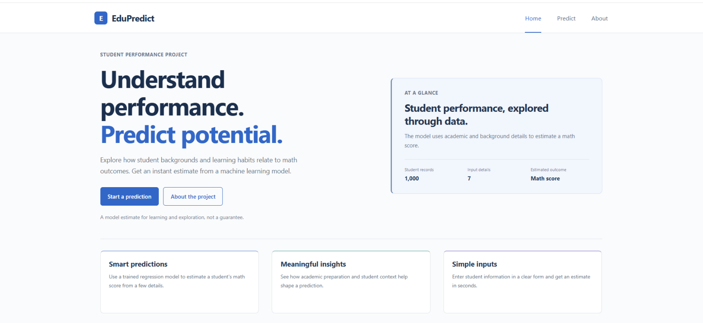
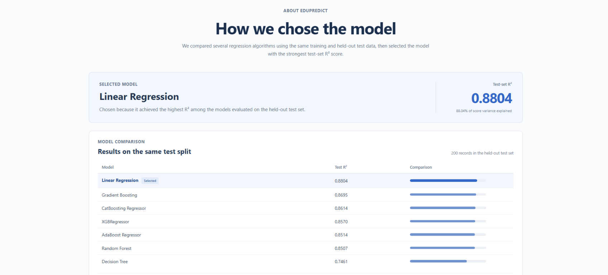
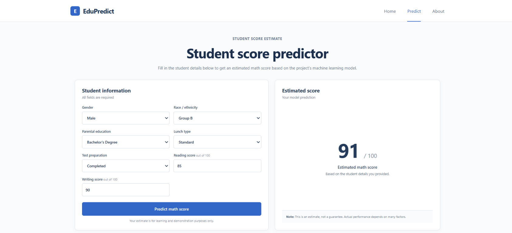

# Student Performance ML

EduPredict is a Flask web app that estimates a student's math score from academic and background information. The project includes a reproducible data and model-training pipeline, a saved evaluation report, and a simple dashboard for exploring predictions. Predictions are estimates for learning and demonstration, not guarantees of actual performance.

## Live app

Try the deployed app: [https://studentperformanceml.onrender.com/](https://studentperformanceml.onrender.com/)

## Dataset

The project uses a dataset of **1,000 student records**. Each record contains seven input features and one target:

| Feature | Type | Description |
| --- | --- | --- |
| `gender` | Categorical | Student gender |
| `race_ethnicity` | Categorical | Student's race/ethnicity group |
| `parental_level_of_education` | Categorical | Parent or guardian's education level |
| `lunch` | Categorical | Standard or free/reduced lunch |
| `test_preparation_course` | Categorical | Whether the student completed the preparation course |
| `reading_score` | Numeric (0–100) | Reading score |
| `writing_score` | Numeric (0–100) | Writing score |
| `math_score` | Numeric (0–100) | **Target** score predicted by the model |

The prediction form collects the seven input features; `math_score` is used as the label during training and is not required as an input at prediction time.

## Feature engineering

The preprocessing pipeline is fitted on the training data and then reused unchanged on the test data and on inputs submitted through the web app:

- Numeric reading and writing scores are imputed with the median and standardized with `StandardScaler`.
- Categorical features are imputed with the most frequent value and converted to indicator columns with one-hot encoding.
- The encoder ignores categories it did not see during training, allowing inference to proceed when a new category is encountered.
- The target, `math_score`, is kept separate from the input features.

The dataset is split into **80% training and 20% held-out test data** with `random_state=42`.

## Model training and selection

The training pipeline evaluates seven regression models on the same held-out test split. For models with configured hyperparameter grids, it runs `RandomizedSearchCV` with 3-fold cross-validation and up to 10 parameter combinations. The model with the highest test-set R² is saved as `artifacts/model.pkl`; the fitted preprocessing pipeline is saved as `artifacts/preprocessor.pkl`.

The current evaluation report selects **Linear Regression**, with a test-set **R² of 0.8804** (200 test records). The comparison below is from `artifacts/model_report.json`:

| Model | Test R² |
| --- | ---: |
| Linear Regression (selected) | 0.8804 |
| Gradient Boosting | 0.8695 |
| CatBoosting Regressor | 0.8614 |
| XGBRegressor | 0.8570 |
| AdaBoost Regressor | 0.8514 |
| Random Forest | 0.8507 |
| Decision Tree | 0.7461 |

R² describes the share of variation in the held-out math scores explained by the model; it is not the percentage of predictions that are correct. Because this report uses the held-out test scores to select the winning model, an additional untouched dataset would be useful for an unbiased final estimate of generalization performance.

## Dashboard

### Home



### Model comparison



### Student score prediction



## Run locally

1. Create and activate a virtual environment:

   ```powershell
   python -m venv venv
   .\venv\Scripts\Activate.ps1
   ```

2. Install dependencies:

   ```powershell
   pip install -r requirements.txt
   ```

3. Start the web app:

   ```powershell
   python app.py
   ```

4. Open `http://127.0.0.1:5000` in your browser.

To re-run data ingestion, preprocessing, model evaluation, and artifact generation, run:

```powershell
python -m src.pipeline.training_pipeline
```

The training pipeline reads `notebooks/data/stud.csv` and writes the train/test splits and trained artifacts under `artifacts/`.

## Project files

- `app.py` — Flask routes for the home, about, and prediction pages.
- `src/components/` — data ingestion, preprocessing, and model evaluation/training.
- `src/pipeline/` — end-to-end training and prediction pipelines.
- `templates/` and `static/` — dashboard pages and styles.
- `artifacts/` — train/test data, fitted model and preprocessor, and model evaluation report.
- `notebooks/` — exploratory data analysis and model-training notebooks.
